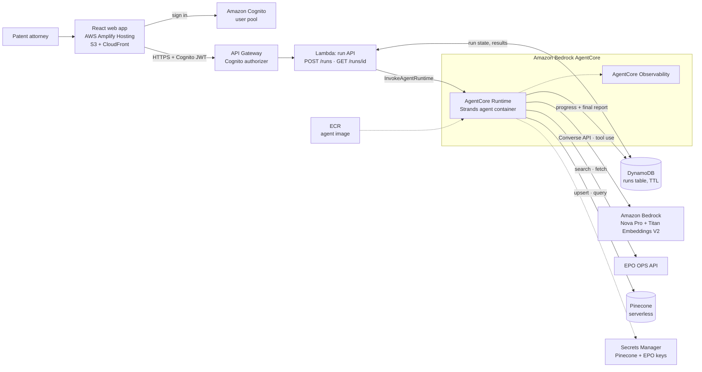
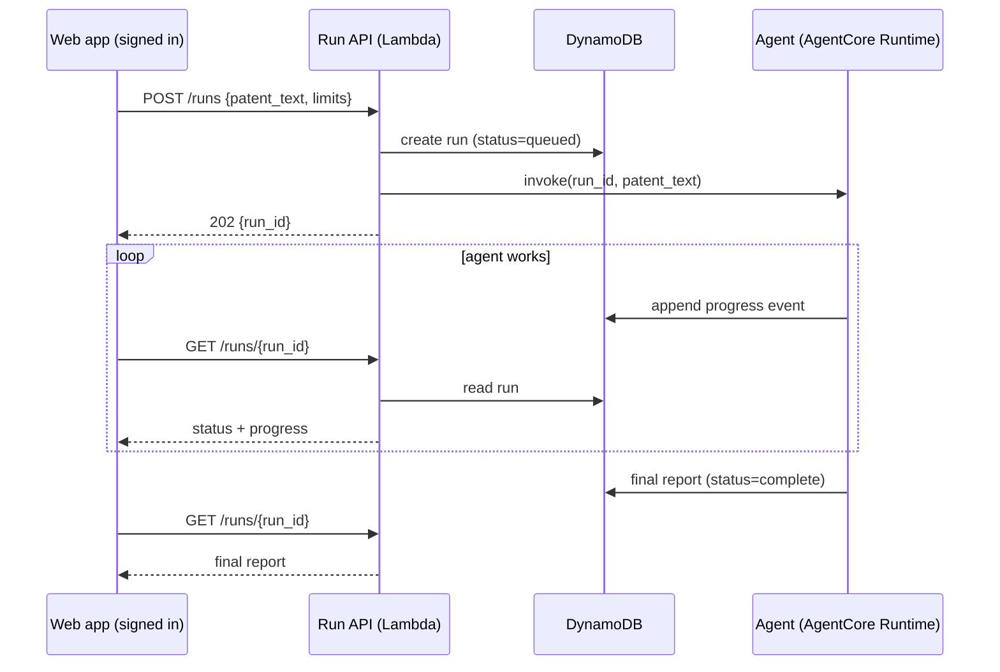

# Patent Prior Art Agent
### An agentic rebuild of the patent prior art search POC, on AWS

An AI agent that performs pre-filing prior art searches. A patent attorney gives it a draft application. The agent works out the core inventive concept, searches the EPO database, refines its search when results are thin, reads the most promising patents in full, and produces an element-by-element novelty assessment with verifiable evidence quotes.

This is the successor to [patent-prior-art-rag](https://github.com/VerneCorpTechnologies/patent-prior-art-rag), a fixed Extract → Retrieve → Map pipeline. That POC proved the idea. This project replaces the fixed pipeline with an agent that decides what to do next.

> **Status: design phase.** The code in `src/` is still the unchanged POC. This README is the target design; nothing described below as "the agent" exists yet.

---

## Why an agent

The POC runs the same three steps in the same order every time. That caused real problems:

| POC problem | How the agent addresses it |
|---|---|
| The EPO search is a single CQL query of 3 keywords joined with `AND`. If it returns nothing, the run ends. | The agent inspects results and retries with broader or rephrased queries (bounded). |
| Mapping only sees whatever top-k chunks Pinecone returned. | The agent can fetch a promising patent's full claim set before judging it. |
| `/retrieve` ingests up to 10 patents synchronously and hits API Gateway's 29-second limit. | Runs are asynchronous: start a run, poll for progress and results. |
| The Pinecone query is not scoped to this run's candidates, so stale chunks can leak in. | Semantic search is filtered to the candidate patent numbers. |
| Evidence quotes come from the LLM and are never checked. | Quotes are validated in code against the retrieved source text. |

**Honest trade-off:** agents are less predictable and cost more tokens than a fixed pipeline. The value here is concentrated in the search loop (retry, read deeper, stop when done). Everything else stays deterministic and is bounded by hard limits.

---

## Goals, non-goals, anti-goals

**Goals**
- Given a draft patent (PDF or text), produce a ranked list of relevant EP/GB prior art with element-by-element mapping and a risk level per patent.
- Recover from weak searches without human help.
- Show its work: every run has a trace of searches, tool calls and reasoning that an attorney can inspect.
- Run serverlessly on AWS at near-zero idle cost.

**Non-goals (v1)**
- Legal advice or a freedom-to-operate opinion.
- Patent offices beyond EPO OPS (EP and GB documents).
- Multi-turn chat or long-term memory across sessions.
- Multi-user accounts, billing, or tenancy.

**Anti-goals (a failure even if it technically works)**
- Presenting an invented or paraphrased quote as evidence.
- Reporting "low risk" because a search found nothing, without saying the search may simply have been inadequate.
- Unbounded loops or unbounded spend on a single run.

---

## Architecture

### Components

| Component | Role |
|---|---|
| **React web app (TypeScript)** | Sign in, upload a PDF, start a run, show live progress, render the report and search log. Extracts PDF text in the browser with pdf.js. A static site with no servers. |
| **AWS Amplify Hosting** | Hosts the web app (S3 + CloudFront under the hood) and rebuilds it on every push to the repo. |
| **Amazon Cognito (user pool)** | Per-user sign-in. Issues JWTs that API Gateway verifies. Replaces the POC's single shared API key. |
| **API Gateway + run API Lambda** | Thin, fast API that starts a run and returns a `run_id`, then serves run status/results. A Cognito authorizer protects every route. Never waits on the agent, so the 29-second limit stops mattering. |
| **DynamoDB (runs table)** | One item per run, keyed by the user's Cognito `sub`: status, progress events, final structured report. TTL expires old runs. Users can only read their own runs. |
| **AgentCore Runtime** | Hosts the agent as a container and runs it for as long as a run takes. Session isolation per run. |
| **Strands Agents SDK** | The agent loop, tool definitions and structured output, written in Python. Runs locally and in AgentCore with the same code. |
| **Amazon Bedrock** | Nova Pro as the reasoning model (swappable, see below). Titan Text Embeddings V2 (1024 dimensions) for vectors. |
| **Pinecone** | Vector store, unchanged from the POC. |
| **EPO OPS API** | Source of patent search and full text. |
| **Secrets Manager** | Pinecone and EPO credentials, replacing `.env` in deployed environments. |
| **AgentCore Observability / CloudWatch** | Traces of every model call and tool call per run. |
| **ECR** | Stores the agent container image. |

### Run lifecycle

---

## The agent

### Tools

Each tool is a plain Python function with a typed signature and docstring. Most wrap POC code.

| Tool | Purpose | Source in POC |
|---|---|---|
| `search_epo(cql)` | Run a CQL query, return candidate patent numbers. | `retrieval/epo_search.py` |
| `ingest_patent(patent_number)` | Fetch, parse, chunk, embed and store a patent. Idempotent. | `ingestion/ingest.py` |
| `semantic_search(query, patent_numbers)` | Query Pinecone, filtered to the given patents. | `retrieval/retriever.py` |
| `get_patent_claims(patent_number)` | Return the full claim set for deep reading. | `ingestion/epo_client.py` + `patent_parser.py` |
| `record_mapping(...)` | Submit one patent's structured mapping. Validated before it is accepted (see below). | new, replaces `mapping/mapper.py` |

Concept extraction is the agent's first reasoning step, returning the same `concept` / `elements` / `problem` structure as the POC, not a separate tool.

### Behaviour

1. **Understand.** Extract the concept, key elements and problem from the draft.
2. **Plan searches.** Write several CQL queries at different breadths, not one.
3. **Search and adapt.** If a query returns too few or irrelevant candidates, broaden or rephrase and retry, up to a limit.
4. **Ingest and rank.** Ingest the top candidates (capped) and run scoped semantic search.
5. **Read deeper.** For the most promising patents, fetch the full claim set.
6. **Map.** For each retained patent, assess every element as `prior_art`, `ambiguous` or `novel` with a quote and a one-sentence explanation. Then set a risk level.
7. **Report.** Return a structured report. If nothing relevant was found, say so and describe the searches tried.

### Guardrails (enforced in code, not in the prompt)

- Maximum number of tool calls and model turns per run.
- Maximum EPO searches (default 5) and patents ingested (default 10).
- Per-run wall-clock timeout.
- **Evidence validation:** `record_mapping` rejects any quote that is not a substring of text actually retrieved in this run. The agent must correct it or mark the element `ambiguous`.
- A run that finds nothing returns an explicit "search may be inadequate" result, never a bare "low risk".

### Output schema

The final report is a Pydantic model, so the UI and tests depend on a fixed shape: the extraction, a list of per-patent mappings (patent number, risk level, overall assessment, per-element status/evidence/explanation), and a search log (queries tried, candidates found).

---

## Technology choices

| Choice | Decision | Reasoning |
|---|---|---|
| Agent framework | **Strands Agents SDK** | Tools are ordinary Python, the loop is debuggable locally, and the code is portable. |
| Hosting | **Amazon Bedrock AgentCore Runtime** | Built for long-running agent sessions, which removes the API Gateway timeout problem. |
| Model | **Amazon Nova Pro** (default) | Continuity with the POC. Strands allows swapping to another Bedrock model with a one-line change if Nova's tool-calling is weak. |
| Embeddings / vector store | Titan V2 (1024-d) + Pinecone | Unchanged. No reason to churn. |
| Frontend | **React + TypeScript on AWS Amplify Hosting** | Replaces Streamlit Community Cloud. Static, serverless, near-zero idle cost, and keeps everything in one AWS account. |
| Auth | **Amazon Cognito** | Draft applications are confidential, so a shared API key is not enough. Per-user accounts and JWTs. |
| Run API | API Gateway + Lambda + DynamoDB | Small, cheap, and keeps the UI decoupled from the agent runtime. |
| IaC | **AWS CDK (Python)** for API, Cognito, DynamoDB, secrets, ECR. | Proposed. The AgentCore Runtime deployment tool may be used for the runtime itself. How to define the Amplify app (CDK or console) is undecided. |
| Evaluation | RAGAS for retrieval quality, plus trajectory checks | See below. |

The model, IaC choice and run-API shape are proposals, not settled decisions.

### Evaluation

The POC's RAGAS scores were weak (answer relevancy 0.28, context recall 0.33) and came from only 3 questions about one patent. For the agent:
- Grow the golden set to several input patents with known relevant prior art.
- Keep RAGAS for retrieval and answer quality.
- Add trajectory checks: did the agent retry after an empty search, stay within its limits, and produce only validated quotes?
- Compare against the POC pipeline on the same inputs, to confirm the agent is actually better.

---

## Security

- Users sign in through Cognito. API Gateway rejects requests without a valid JWT, and the run API only returns runs belonging to the caller's `sub`.
- Self-signup is disabled in v1: accounts are created by an admin.
- CORS is restricted to the web app's origin instead of `*`.
- Agent runtime IAM role limited to: invoking the two Bedrock models, reading its secrets, writing to the runs table.
- Secrets live in Secrets Manager, not in the image or environment files.
- Uploaded patent text is stored only in the runs table, with a TTL.

---

## Roadmap

1. **Local agent.** Strands agent running locally with the existing functions as tools. Decide from real runs whether the agent beats the POC.
2. **Hardening.** Guardrails, evidence validation, structured output, fixes to the claim parser and Pinecone scoping.
3. **Evaluation.** Expanded golden set and trajectory checks.
4. **AWS backend deployment.** AgentCore Runtime, run API, Cognito, DynamoDB, Secrets Manager, observability, via CDK.
5. **Web app.** New React + TypeScript app on Amplify Hosting: sign in, upload a PDF, start a run, poll for progress, and render the report and search log. The Streamlit UI is retired.

Deploy only if step 1 shows the agent is worth it.

---

## Assumptions to verify

This design was written from memory of AWS's agent services, not from current docs. Check before building:

- Nova Pro tool-calling quality, and its support in Strands and AgentCore in `us-east-1`.
- AgentCore Runtime: maximum run duration, how an async/background run is started, container requirements (architecture, entrypoint contract), pricing, and regional availability.
- Invocation auth from a Lambda to AgentCore Runtime (IAM/SigV4 versus OAuth).
- Whether Strands structured output works with Nova models.
- Whether API Gateway is needed at all, or a Lambda Function URL would do.
- Whether the browser could call AgentCore Runtime directly with a Cognito JWT, which would remove the Lambda and DynamoDB layer. This is not planned for v1: a closed tab would lose the run, and it is unclear whether AgentCore supports browser calls and streaming.

## Open questions

- Should the agent's search also use CPC classification codes and applicant/inventor filters, not just keywords?
- How should the UI show uncertainty when the search is inadequate?
- Is pdf.js in the browser good enough for PDF text extraction, or should PDFs upload to S3 and be parsed server-side with the existing `pypdf` code? Scanned PDFs fail either way.
- Will anyone other than you use this? If not, Cognito could be deferred, but the design assumes it from the start.
- Is DynamoDB polling good enough, or is streaming worth the extra complexity?
- How many input patents do we need in the golden set before evaluation results mean anything?

---

## Carried over from the POC

**Concept-first retrieval.** The agent searches on the extracted inventive concept, not raw claim text. Claims are written in broad, abstract legal language, so retrieving on them finds similar phrasing rather than similar inventions.

**Structure-aware chunking.** Each claim is an atomic chunk, never split mid-sentence.

**Serverless.** No idle servers; cost scales with use.

The POC's setup, configuration and test instructions remain valid for the existing code in `src/` until it is converted. See the [POC repo](https://github.com/VerneCorpTechnologies/patent-prior-art-rag) for them.

---

## Author

David Verne — [LinkedIn](https://linkedin.com/in/david-verne-329385103)
